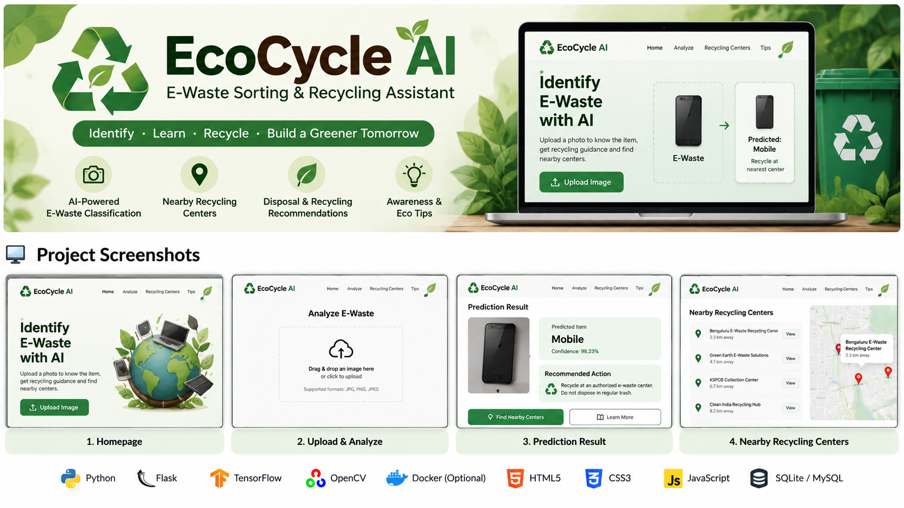
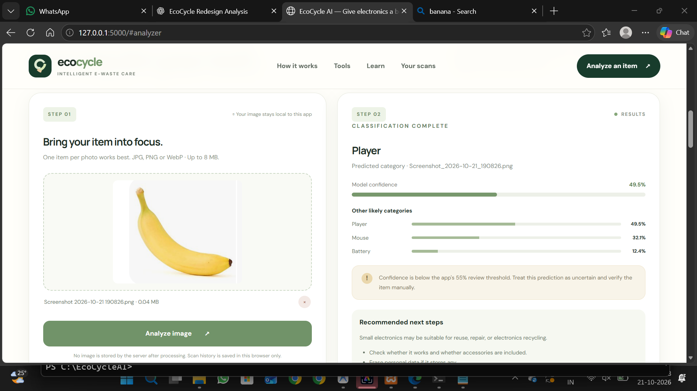
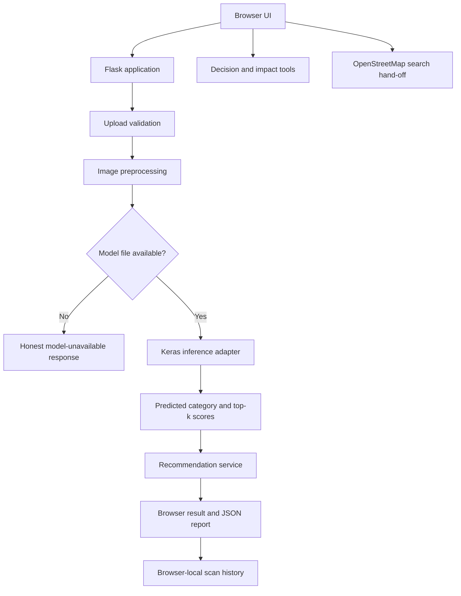

<p align="center">
  
</p>
# EcoCycle AI — Flagship Studio Release

**A sustainability-tech web application for e-waste image classification, safer next-step guidance, and circular-use decisions.**

EcoCycle AI combines a redesigned responsive interface with a Flask API, a Keras e-waste classifier downloaded automatically from a public Hugging Face model repository on the first scan, category-specific handling guidance, a decision assistant, a transparent waste-mass estimator, OpenStreetMap search hand-off, browser-local scan history, and JSON report export.

> **First-run requirement:** you do not need to supply a dataset, train a model, or create an API key. Run `START_ECOCYCLE.bat` on Windows. The launcher installs dependencies; the first image scan downloads the public model and caches it locally. An internet connection is required for setup/model download. This community model has not been independently benchmarked by this project; confirm predictions manually and do not use them as a safety certification.
---

## 📸 Project Screenshots

### AI E-Waste Analyzer


### Project Banner

## What is implemented

- **Responsive product UI:** forest-green, sage, and warm-ivory design system; accessible labels; keyboard-friendly forms; mobile navigation; reduced-motion support.
- **Image upload flow:** JPG/PNG/WebP validation, 8 MB limit, preview, drag-and-drop, and clear server-side errors.
- **Inference API integration:** Flask endpoint, image validation, RGB conversion, 224 × 224 resize, MobileNetV2-style scaling, top-three output handling, and explicit missing-model behavior.
- **Category-specific recycling advisor:** conservative handling recommendations for battery, keyboard, microwave, mobile, mouse, PCB, player, printer, television, and washing machine.
- **Smart disposal decision assistant:** considers working condition, damage/battery concerns, data privacy, and repair/reuse preference.
- **Impact estimator:** estimates item mass using transparent illustrative defaults or user-entered weight. It does not claim carbon savings.
- **Collection route finder:** opens OpenStreetMap search for a user-provided location and selected service type. Listings and acceptance policies are not verified by EcoCycle.
- **Browser-local scan history:** actual successful inference results only; summary counts are derived from local history. No fabricated sample activity.
- **Exportable analysis report:** downloads JSON with category, confidence, timestamp, recommendations, and limitations.
- **Learning hub:** practical notes on data privacy, battery safety, reuse, and local rules.
- **Tests and documentation:** focused unit tests, model card, setup instructions, and verification notes.

## Architecture



## Project structure

```text
EcoCycle_AI_Flagship_Studio_Release/
├── app.py
├── app/
│   ├── __init__.py
│   ├── routes.py
│   ├── model_service.py
│   ├── recommendations.py
│   ├── templates/
│   │   └── index.html
│   └── static/
│       ├── styles.css
│       └── app.js
├── tests/
│   └── test_app.py
├── models/                  # add compatible model here; weights not included
├── data/
│   └── README.md
├── requirements.txt
├── requirements-ml.txt
├── .env.example
├── MODEL_CARD.md
├── VERIFICATION.md
└── README.md
```

## Prerequisites

- Python 3.10 or 3.11 recommended.
- pip and a virtual environment.
- Python 3.11 recommended on Windows.
- Internet access for first-time package installation and automatic public model download. After the model is cached, classification can run locally.
- No API key, dataset, account, or manual model placement is required for the default setup.

## One-click setup (Windows)

1. Extract the ZIP to a normal writable folder.
2. Install Python 3.11 from [python.org](https://www.python.org/downloads/windows/) if it is not already installed. During setup, enable the Python launcher / PATH option.
3. Double-click **`START_ECOCYCLE.bat`**.
4. Wait for dependency installation. The browser opens at `http://127.0.0.1:5000`.
5. Upload an e-waste image. The first scan automatically downloads the 11.6 MB public model artifact; keep the terminal open and wait for the first scan to finish.

The launcher creates a project-local `.venv`, installs requirements, and starts Flask. Later starts reuse the environment and cached model. Keep the terminal window open while using the app.

### Manual setup (optional)

```powershell
py -3.11 -m venv .venv
.\.venv\Scripts\python.exe -m pip install --upgrade pip
.\.venv\Scripts\python.exe -m pip install -r requirements.txt
.\.venv\Scripts\python.exe app.py
```

Open `http://127.0.0.1:5000`.

### macOS / Linux

```bash
chmod +x start_ecocycle.sh
./start_ecocycle.sh
```

### AI model and dataset

- Model source: [`sanchita144/e-waste-mobilenetv2` on Hugging Face](https://huggingface.co/sanchita144/e-waste-mobilenetv2).
- The app downloads `e_waste_mobilenetv2.keras` automatically on the first prediction and stores a local copy in `models/`.
- No dataset is needed for inference. A dataset is only required to retrain or independently evaluate the model.
- The model repository currently provides limited model-card/evaluation detail. The app checks that the model loads and has ten output scores, but does **not** independently verify its label order, accuracy, calibration, or safety. The ten labels follow the commonly used alphabetical order for this dataset; verify mapping before making formal performance claims.
- The public repository's license/usage terms should be reviewed before commercial use. This release does not claim ownership of third-party model weights.
- If automatic download fails, check internet access and retry the scan. No fallback or mock prediction is generated.

## API

### `GET /api/health`
Reports whether the configured model file exists. It does not certify model compatibility or quality.

### `POST /api/predict`
Multipart form field: `image`. Accepted extensions: `.jpg`, `.jpeg`, `.png`, `.webp`. Maximum request upload: 8 MB.

Success response contains `prediction`, `confidence`, `low_confidence`, `top_k`, `guidance`, and `filename`. Error responses use appropriate HTTP status codes; a missing model returns HTTP 503 and does not include a fake prediction.

### `GET /api/guidance/<category>`
Returns conservative guidance for a known category or general electronic waste.

## Privacy and security notes

- Uploaded image bytes are processed in memory and are not intentionally saved to disk by the inference route.
- Scan history lives in the browser's local storage on that device and browser. Clearing browser storage removes it.
- Do not upload private or sensitive images to an exposed public deployment without an appropriate privacy review.
- The development app binds to `127.0.0.1`, has no user accounts, and is not hardened for public multi-user deployment.
- Before deployment, configure a real secret, use a production WSGI server, enforce HTTPS, add rate limiting and monitoring, review CORS/session policy if applicable, and conduct security testing.
- OpenStreetMap search results are third-party data. EcoCycle does not verify provider authorisation, hours, prices, or item acceptance.

## Testing

Run:

```bash
python -m unittest discover -s tests -v
```

Tests cover the homepage, health status, upload extension validation, missing-model honesty, image preprocessing, and recommendation guidance. See `VERIFICATION.md` for the checks performed in the packaging environment.

## Known limitations

- The third-party model is downloaded at runtime rather than bundled in the ZIP, keeping the archive lean. First-run internet access is required.
- Expected class order and preprocessing are based on the public model's intended MobileNetV2 setup but have not been independently validated against its training code; verify before making accuracy claims.
- The local finder delegates to OpenStreetMap and does not verify centre authorisation or live availability.
- The impact tool estimates mass only; it is not a life-cycle assessment or carbon calculator.
- Scan history is browser-local, not a server database or account-synced history.
- No live user authentication, database persistence, deployment pipeline, or production monitoring is included.

## Portfolio description (adapt truthfully)

> Built a responsive e-waste guidance application using Flask, JavaScript, and a Keras-based ten-class e-waste image classifier sourced from a public model repository and downloaded automatically at first use. Implemented upload validation, model loading and inference integration, category-specific disposal recommendations, a guided repair/reuse/recycle decision flow, an illustrative waste-mass estimator, browser-local scan history, and JSON report export. Third-party model performance and class mapping require independent verification; no accuracy claim is made.
